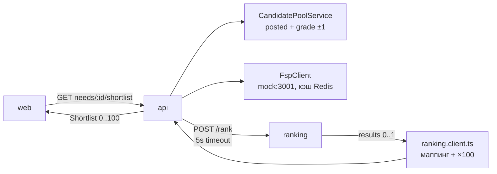

# HANDOFF — рекомендательная система (`apps/ranking`)

Полное описание того, что уже сделано по рекомендательной системе: контекст, спека, состояние, что покрыто тестами, где разрывы, что дальше.

Формат: **документация** (как пользоваться) → **системный анализ** (как это устроено и что не сходится) → **хэндофф** (что делать следующему).

Техническое описание самого сервиса — [`README.md`](README.md), сценарии интеграции — [`INTEGRATION.md`](INTEGRATION.md).

---

## 1. Статус на 2026-10-08

| Блок                      | Состояние                                                                     |
| ------------------------- | ----------------------------------------------------------------------------- |
| Сервис `POST /rank`       | Работает, детерминированный правила-движок `rules-v1.0.0`                     |
| `POST /career/analyze`    | Работает, counterfactual-действия по пробелам                                 |
| `GET /health`             | Работает, отдаёт `modelVersion`                                               |
| Интеграция с Nest         | Работает, маппинг в `apps/api/src/modules/employers/ranking.client.ts`        |
| UI-объяснения             | Работают: `breakdown`, `reasons`, `risks` → «Почему подходит»                 |
| Тесты Python              | 28 pytest + gold + benchmark + perf в `scripts/check.sh`                      |
| Docker-образ              | Собирается и проходит smoke по трём эндпоинтам                                |
| LTR (lightgbm)            | Только offline: `evaluation/train_ltr.py` обучает модель, сервис её не грузит |
| Персонализация / semantic | Модель умеет, живой контракт их не передаёт — см. §5                          |
| Тесты Nest/веб            | Нет вообще                                                                    |
| CI                        | Нет: `.github` содержит только `PULL_REQUEST_TEMPLATE.md`                     |

**Ни один сервис, БД или Nest-модуль не добавлялся.** `ranking` остаётся stateless: ни хранилища, ни очередей, ни LLM в горячем пути.

---

## 2. Что сделано

### 2.1 Сервис

- `schemas.py` — Pydantic-модели входа/выхода: `RankRequest` (алиасы `vacancy` и `hiringNeed`, ровно одна из двух), `CandidateSnapshot`, `HiringNeedSnapshot`, `RankingContext`, `ScoreBreakdown`, `RankItem`, `CareerAnalyzeRequest/Response`.
- `scoring.py` — весь скоринг: hard filters (`eligibility`), три под-оценки, геометрическая сборка `matchScore`, reason/warning-коды, сортировка `rank_candidates`. Версия модели `MODEL_VERSION = "rules-v1.0.0"` — единая точка истины, её же отдаёт `/health`.
- `career.py` — `analyze_career`: сильные матчи сейчас, действия (профит/улучшение), пробелы по навыкам.
- `taxonomy.py` — нормализация имён навыков (латиница/кириллица/`c++`/`go`), таблица `RELATED`, `canonical_skill`, `skill_match`.
- `main.py` — три ручки FastAPI, ноль бизнес-логики.
- `Dockerfile` + `.dockerignore` — образ `python:3.12-slim`, только runtime-зависимости.

### 2.2 Оценка качества

- `evaluation/validate_gold.py` — проверка gold-набора: группы, метки, полнота.
- `evaluation/benchmark.py` — `ndcg@k`, `precision@k`, `mrr` по `evaluation/data/sanity_gold.jsonl`.
- `evaluation/performance.py` — синтетическая нагрузка, avg latency и throughput.
- `evaluation/train_ltr.py` + `features.py` — offline LTR: `LGBMRanker` по признакам `ScoreBreakdown`, выход `model.txt` + `model.meta.json`.
- `evaluation/data/sanity_gold.jsonl` — 12 пар, 3 группы, метки 0..3.
- `scripts/check.sh` — **одна команда на все проверки**: compileall → pytest → validate → benchmark → performance.

### 2.3 Покрытие тестами (28 pytest)

`tests/test_ranking.py` — 22 теста: каноникализация алиассов, порядок кандидатов, все hard filters, verified vs claimed grade, строгие must-have, бонус verified-навыка, нейтральность FSP, обратная совместимость `vacancy`, ошибки валидации, `health`, легаси-поле `score`, комбинация `hiringNeed`+`vacancy`, hidden-кандидат, relocation, intent по availability/freshness.
`tests/test_career.py` — 4 теста: counterfactual-действие, приоритет верификации над прокачкой, пустой рынок, посторонняя специализация.
`tests/test_examples.py` — 2 теста: `examples/rank-request.json` и `examples/career-request.json` из README проходят валидацию и исполняются.

### 2.4 Интеграция с остальным репозиторием

- `apps/api/src/modules/employers/ranking.client.ts` — адаптер контракт ↔ `/rank` (таблица соответствия в `INTEGRATION.md`), шкала ×100, заполнение `qualification`/`opportunityFit`/`risks`/`breakdown`, таймаут 5 с → `503`.
- `apps/api/src/modules/employers/employers.service.ts` — `shortlist` использует реальный `modelVersion`, а не заглушку.
- `apps/web/src/shared/lib/labels.ts` — `reasonText()` переводит reason/warning/rejectedBy коды, включая составные (`skill_missing:python`, `must_skills_2_of_3`).
- `apps/web/src/pages/employer/ui/{ReasonList,WhyMatch}.tsx` — отображение причин и групп `breakdown`.

---

## 3. Как это устроено (системный анализ)

### 3.1 Поток данных



Соглашение о вине: **правила отбора в пул — бизнес-логика Nest, оценка — `apps/ranking`.** Пул отсекает по специализации и грейду ±1; ranking не отвечает за то, кого показывают, только за порядок и объяснения.

### 3.2 Формулы

Три под-оценки, все в `[0..1]`:

```text
qualification = 0.10·специализация + 0.14·грейд        + 0.20·must
              + 0.09·must(только verified)             + 0.04·nice
              + 0.12·компетенции                       + 0.09·assessment
              + 0.09·опыт                              + 0.08·semantic
              + 0.03·fsp                               + 0.02·персонализация   = 1.00

opportunity   = 0.35·зарплата + 0.22·формат + 0.12·локация
              + 0.08·занятость + 0.13·целевая роль + 0.10·желаемый стек         = 1.00

intent        = availability[1.0 | 0.90 | 0.58 | 0] · (0.62 + 0.38·freshness)

matchScore    = eligibility_ok ? Q^0.55 · O^0.30 · I^0.15 : 0
```

`matchScore` — **геометрическое** среднее с нулевым показателем намеренно: слабое звено роняет итог сильнее, чем линейная компенсация. Нелинейность `Q^0.55` даёт «плюс за крохи» в верхней части шкалы.

Hard filters (`eligibility`), любой срабатывает → `matchScore = 0`, кандидат остаётся в выдаче с `rejectedBy`:

| Код                           | Условие                                    |
| ----------------------------- | ------------------------------------------ |
| `candidate_hidden`            | `availability = hidden`                    |
| `specialization_mismatch`     | строгая специализация (в контракте всегда) |
| `grade_below_minimum`         | `strictGrade`                              |
| `salary_incompatible`         | `strictSalary` — в Nest всегда `true`      |
| `work_mode_incompatible`      | `strictWorkMode` — в Nest всегда `true`    |
| `location_incompatible`       | `strictLocation`                           |
| `critical_must_skill_missing` | `strictMustSkills`                         |

В Nest: `strictSalary=true`, `strictWorkMode=true`, `strictGrade/strictMustSkills/strictLocation=false` — потому что пул уже отфильтрован по грейду, а бюджет и формат работодателя считаются жёсткими.

Reasons (почему подходит, максимум 7) / warnings (риски, максимум 8) — `_reasons_and_warnings`, коды переведены в `labels.ts`.

### 3.3 Верификация и доверие

Центральное правило продукта «verified talent matching» реализовано в четырёх местах:

1. `_grade_fit`: `verifiedGrade` домножается на `0.80 + 0.20·gradeConfidence`, `claimedGrade` — на `0.72` (заявленный не бесполезен, но слабее).
2. `_best_skill_score`: verified даёт `+0.08`, не-verified штрафуется `×0.78`.
3. `qualification` содержит отдельный слагаемый `0.09·verified_must` поверх `0.20·must`.
4. `verificationState` (`self_declared/queued/verified/unsupported`) нормализуется в `SkillEvidence` валидатором: `verified → state=verified`, и наоборот.

### 3.4 Детерминизм

Ни случайности, ни часов, ни внешних вызовов внутри `score_pair`. Один и тот же вход → побайтово тот же выход, поэтому и `rules-v1.0.0` в `/health`, и золотой набор детерминированы. Это же главный актив для будущих тестов (см. §6).

---

## 4. Как пользоваться

```bash
# окружение: Python 3.12 (системный 3.9 не подходит), вне apps/ranking!
python3.12 -m venv ../rank-venv
source ../rank-venv/bin/activate
pip install -r requirements-dev.txt
# для LTR дополнительно: pip install -r requirements-ml.txt  (+ brew install libomp)

# запуск
uvicorn main:app --port 8000
# либо контейнер
docker build -t hh-ranking apps/ranking && docker run -p 8000:8000 hh-ranking

# все проверки
sh scripts/check.sh

# поштучно
pytest -q
python evaluation/validate_gold.py evaluation/data/sanity_gold.jsonl
python evaluation/benchmark.py evaluation/data/sanity_gold.jsonl
python evaluation/performance.py --candidates 1000 --runs 2
python evaluation/train_ltr.py evaluation/data/sanity_gold.jsonl
```

Готовые запросы — `examples/rank-request.json`, `examples/career-request.json`. Zod-совместимость с ними гарантирует `tests/test_examples.py`.

Венв **не должен** лежать в `apps/ranking/`: `check.sh` гоняет `python -m compileall .` по каталогу и начнёт компилировать содержимое venv.

---

## 5. Разрывы между моделью и живым контрактом

Модель полная, но Nest передаёт часть полей с дефолтами. Проверено чтением `ranking.client.ts`:

| Сигнал                         | В модели                                | В живом запросе | Эффект                                                  |
| ------------------------------ | --------------------------------------- | --------------- | ------------------------------------------------------- |
| `semanticSimilarity`           | `0.08·semantic`, `[-1..1]`, дефолт 0.65 | не передаётся   | **константа 0.65** — нулевая дифференциация             |
| `context.skillBoosts/…`        | `0.02·персонализация`, дефолт 0.5       | не передаётся   | **константа 0.5**                                       |
| `profileFreshness`             | в `intent`, дефолт 1.0                  | не передаётся   | **константа 1.0**, `profile_stale` не срабатывает       |
| `competencyWeights` (need)     | `0.12·компетенции`                      | не передаются   | откат на `assessmentScore` → компетенции дублируют тест |
| `competencies` (candidate)     | то же                                   | не передаются   | то же                                                   |
| `experienceMin/Max`            | `0.09·опыт`                             | не передаются   | всегда дефолт 0.80                                      |
| `locations`, `employmentTypes` | `0.12·локация`, `0.08·занятость`        | не передаются   | нейтральный 0.75                                        |
| `desiredSkills`                | `0.10·желаемый стек`                    | не передаются   | нейтральный 0.75                                        |
| `salaryMax`, `relocation`      | в `opportunity`                         | не передаются   | грубее оценка зарплаты/локации                          |

Итог: в проде реально работают специализация, грейд, навыки, assessment, опыт, FSP, зарплата, формат и целевая роль. Semantic и персонализация — «мёртвый код в горячем пути», он есть в спеке и в тестах, но не подключён к контракту.

Дополнительно: `ModelVersion` в ответе — `rules-v1.0.0`, LTR-модель в `main.py` не загружается вообще. Это осознанно (см. §6), но значит, что «learning-to-rank» пока не влияет на выдачу.

---

## 6. Ограничения и риски

1. **Gold-набор — sanity, а не рыночный.** 12 рукописных пар. Метрики `ndcg@5=1.0` выглядят отлично, но на них нельзя строить выводы о качестве ранжирования в проде.
2. **LTR не в проде.** Нужен held-out gold-набор, фиксация seed, сравнение LTR против правил на тех же метриках и решение по гейту. Иначе `model.txt` — артефакт без потребителя.
3. **Semantic считается не у нас.** Кто-то должен считать `semanticSimilarity` (embedding/перекрёстный энкодер) и класть его в снапшот — иначе вес 0.08 — это плоская 0.65 для всех.
4. **Нет CI.** `scripts/check.sh` нужно запускать руками, `.github/workflows` отсутствует.
5. **Нет тестов на стороне Nest.** Адаптер `ranking.client.ts` — самое хрупкое место (280 строк ручного маппинга), покрыт только ручным сквозным прогоном.
6. **Нет тестов веба.** `reasonText` и `BreakdownGroup` легко сломать правкой кодов.
7. **Fallback при недоступности — `503`.** Подборка не отдаётся вообще. Альтернатива (показать список без оценок) не реализована — это продуктовое решение, не ошибка.
8. **Набор причин хрупок:** `reasons[:7]`/`warnings[:8]` обрезают молча, порядок кодов = порядок построения, а не значимость.
9. **Скор — интегральный, без пере-нормировки.** При добавлении нового слагаемого в `qualification` веса перестают давать 1.0 и итог молча «съезжает». Сейчас нигде нет теста `sum(weights) == 1`.

---

## 7. Хэндофф

### 7.1 Точка входа для нового инженера/агента

1. [`docs/dev/AGENT_HANDOFF.md`](../../docs/dev/AGENT_HANDOFF.md) — правила репозитория, команды, как не сломать чужое.
2. [`README.md`](README.md) — спека сервиса, формулы, коды причин.
3. [`INTEGRATION.md`](INTEGRATION.md) — что передаёт Nest и почему.
4. `scoring.py` — единственное место с формулами. Менять веса только вместе с обновлением этой таблицы и `breakdownGroups` в `ranking.client.ts`.
5. `scripts/check.sh` — перед любым коммитом.

### 7.2 Правила при доработке

- Меняешь формулу/веса → обнови **одновременно**: `MODEL_VERSION` (bump `rules-v1.0.0` → `rules-v1.1.0`), веса в `breakdownGroups` (`ranking.client.ts`), таблицу в `README.md` и `HANDOFF.md`, gold-набор, если порядок пар меняется.
- Меняешь контракт `/rank` → правишь только адаптер, `@hh/contracts` не трогаешь (см. `contracts/README.md`).
- Новый код reason/warning → пункт в `apps/web/src/shared/lib/labels.ts`, иначе в UI увидишь `skill_foo`.
- Доменные числа для eval (навыки, бюджеты, веса компетенций) добавляются только в `evaluation/fixtures.py`. Тесты держат свой минимальный словарь намеренно (одна гипотеза — один набор полей), gold-набор — размеченные данные: их не унифицируем.
- Списки констант, продублированные между языками (веса `qualification`/`opportunity` ↔ `breakdownGroups`, `FEATURE_ORDER` ↔ `ScoreBreakdown`, `taxonomy.py` ↔ `skill-catalog.ts`), сверяются автотестами, а не вручную — см. issue #34, этап 8.
- Ни в коем случае не добавляй в `apps/ranking`: БД, Redis, очереди, HTTP-вызовы в `score_pair`, LLM в горячем пути.
- Venv и ML-артефакты (`model.txt`, `model.meta.json`, `.pytest_cache`) в git не попадают — уже в `.gitignore`.

### 7.3 Что делать дальше

Заведённые issues по ML-части, в порядке приоритета:

1. [#34 — план полного покрытия тестами](https://github.com/DjonniStorm/hh-but-it-works/issues/34): инварианты (нормировка весов, детерминизм, монотонность), property-based, edge cases схем, автосверка констант.
2. [#35 — интеграционные тесты Nest ↔ ranking и CI](https://github.com/DjonniStorm/hh-but-it-works/issues/35): маппинг адаптера, `shortlist`, веб-переводы, workflow.
3. [#36 — довести модель до идеала](https://github.com/DjonniStorm/hh-but-it-works/issues/36): подключить мёртвые сигналы контракта, нормальный gold-набор, LTR против правил, калибровка, мониторинг.
