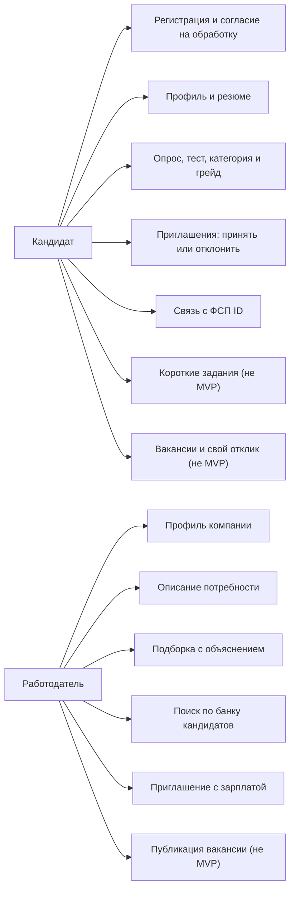
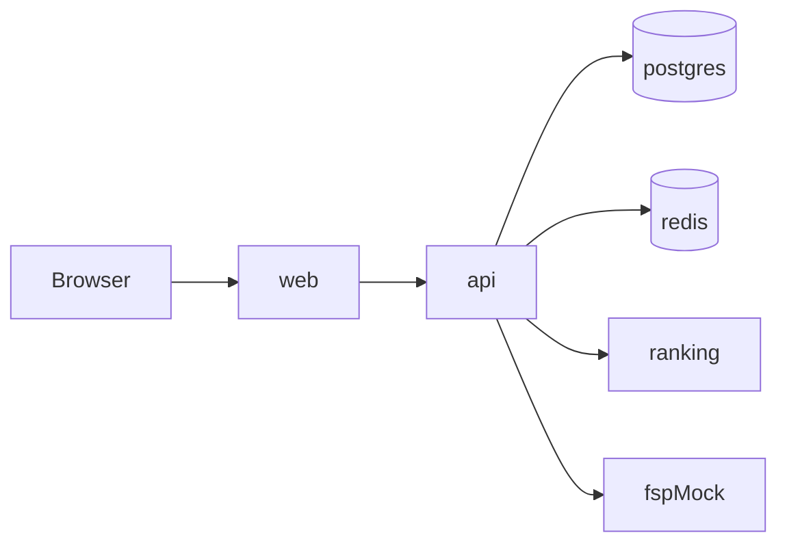

# Где что лежит

pnpm workspace: `apps/web`, `apps/api`, `apps/mock`, `packages/*`. `apps/ranking` на Python и в workspace не входит.

Локально Postgres, Redis, ranking и mock:

```bash
docker compose --env-file infra/dev/.env.example -f infra/dev/docker-compose.yml up
```

Порты: Postgres `5432`, Redis `6379`, ranking `8000`, mock `3001`. Логин, пароль и база Postgres — `hh`.

Брендбук: [docs/dev/model.md](model.md).

# Сценарии

Узлы с пометкой «не MVP» в ТЗ необязательны.



# Компоненты

`ranking` без своей БД. `fspMock` снаружи, пустая история — обычный ответ, не ошибка продукта. Redis только для очередей и rate limit, не для бизнес-состояния.


