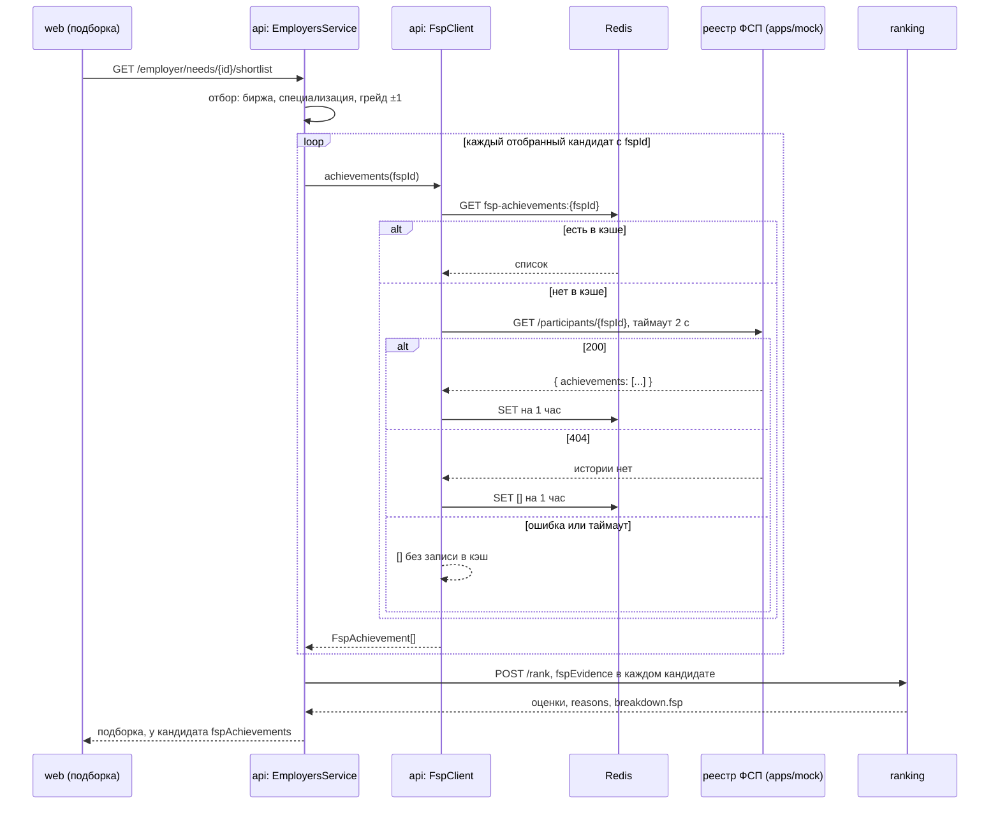

# Интеграция с реестром ФСП

Достижения кандидата в соревнованиях ФСП — вспомогательный сигнал в подборке. Фильтром они не бывают: кандидат без истории ФСП попадает в подборку на общих правилах ([matching.md](matching.md)).

Настоящего API реестра у нас нет. Его заменяет мок `apps/mock` с тем же контрактом, что ждёт клиент.

## Схема



## Клиент

[`FspClient`](../../apps/api/src/modules/employers/fsp.client.ts), модуль `employers`.

| Что            | Как                                                                                 |
| -------------- | ----------------------------------------------------------------------------------- |
| Адрес          | `FSP_URL` из `apps/api/.env`, по умолчанию `http://localhost:3001`                  |
| Запрос         | `GET /participants/{fspId}` на каждого кандидата подборки                           |
| Таймаут        | 2 с (`AbortSignal.timeout`), зависший реестр не держит подборку                     |
| Кэш            | Redis, ключ `fsp-achievements:{fspId}`, TTL 1 час                                   |
| `404`          | пустая история `[]`, кэшируется как обычный ответ                                   |
| `5xx`, таймаут | `[]` для этой загрузки, в кэш не пишется, чтобы сбой не держался час; в логе `warn` |
| Redis лёг      | запрос идёт в реестр напрямую, в логе `warn`                                        |
| Нет `fspId`    | `[]` без запроса                                                                    |

Ответ реестра проверяется по полям. Достижение без строкового `title` или числового `year` отбрасывается, `place` не число — `null` («участник»).

Кандидат может скрыть достижения ФСП в анкете (`showFsp`). Реестр всё равно опрашивается, но в снимок, в `/rank` и в карточку уходит пустой список.

`fspId` кандидат вводит в анкете сам. Реестр не подтверждает, что id принадлежит ему (роадмап #31, раздел A, задача #20).

## Мок реестра

[`apps/mock`](../../apps/mock): Bun + Elysia, порт `3001`, в compose — сервис `mock`.

```text
GET /participants/:fspId
200 { "achievements": [{ "title": "...", "year": 2025, "place": 1 }] }   place: null — участник без места
404 { "message": "История ФСП не найдена" }                                   истории нет
```

Проверка: `curl localhost:3001/participants/fsp-b104` — два достижения, `curl -i localhost:3001/participants/fsp-unknown` — `404`.

**Правило синхронизации.** Участники мока — те же люди, что сид-кандидаты API в [`candidate-seed.data.ts`](../../apps/api/src/modules/profiles/candidate-seed.data.ts). `fspId` сид-кандидата — `"fsp-" + код` (`fsp-b101`, `fsp-f202`), и он есть только у тех, у кого в сиде непустой `fsp`. Правишь достижения в одном месте — правь во втором. Плюс `fsp-demo` для ручной проверки.

Подменить мок настоящим реестром — поменять `FSP_URL`, если контракт тот же. Иначе переписать разбор ответа в `FspClient.fetchAchievements`.

## Как это влияет на подборку

- `RankingClient` передаёт достижения в `/rank` как `fspEvidence`, каждому достижению — вес по месту.
- В квалификационной части оценки у ФСП вес 0,06 из 1 (`scoring.py`), в разборе это группа `fsp`. Место: 1 — 0,9, 2 — 0,75, 3 — 0,6, без места — 0,5. Без истории кандидат не теряет допуск и других баллов, он только не получает этот бонус (тест `test_fsp_absence_is_neutral_not_gate` в `apps/ranking`).
- Уточнение «Есть достижения ФСП» в `RefinementBar` оставляет кандидатов с достижениями или с навыком, подтверждённым внешне (`verified_external`).

## Что видит работодатель

Карточка кандидата в подборке, блок «Достижения ФСП» ([`FspHistory`](../../apps/web/src/pages/employer/ui/FspHistory.tsx)):

- есть история — список «название, год — N место» или «— участник»;
- истории нет, реестр не ответил или кандидат скрыл достижения — «Истории ФСП нет — оценка по тесту и навыкам.» Это не минус кандидату.

В «Почему подходит» вклад ФСП виден отдельной строкой «Достижения ФСП» в разборе оценки. Сам `fspId` работодателю не показывается.
