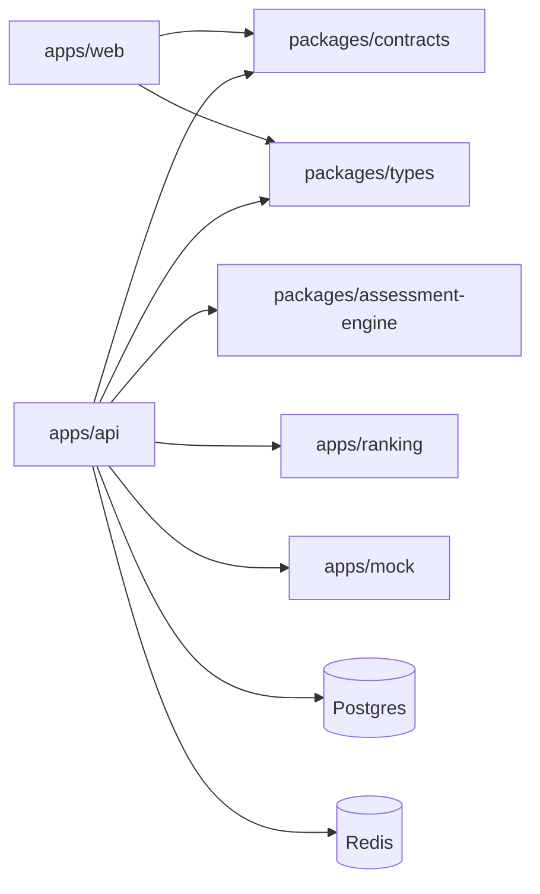

# Код

pnpm workspace: `apps/web`, `apps/api`, `apps/mock`, `packages/*`. Сервис ранжирования на Python в workspace не входит. Новые Nest-модули без согласования не заводят.

| Пакет                   | Зачем                                         |
| ----------------------- | --------------------------------------------- |
| `@hh/types`             | Enum и каталог навыков                        |
| `@hh/contracts`         | Zod-схемы запросов и ответов                  |
| `@hh/assessment-engine` | Сборка попытки, проверка ответов, целостность |

Новая или изменённая ручка: схема в `packages/contracts`, DTO в API, затем `pnpm openapi`. Клиент пишется в `apps/web/src/shared/api/generated`. Этот каталог руками не правят.

Как писать код в этом репозитории: `AGENTS.md` в корне клона и папка `docs/dev/`. Этот сайт их не копирует.
