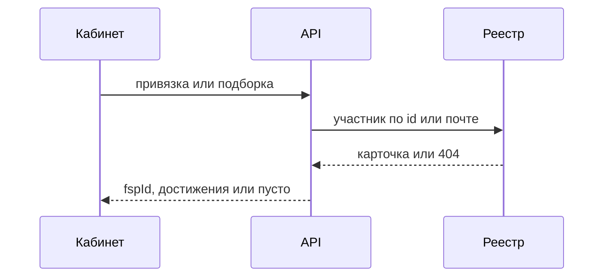

# ФСП

Реестр Федерации спортивного программирования нужен, чтобы показать достижения в анкете и дать ranking небольшой бонус `fspEvidence`. Пустая история не отсекает кандидата: нет ID или реестр ответил 404, подборка всё равно считается.

Bun и Elysia, сид и тестовые `fsp-b101`: страница [мока](/stack/fsp-mock).

## Как привязывают

В кабинете кнопка уводит на страницу входа реестра. Код меняется на `fspId` внутри API. Почту можно сверить заранее: `GET /participants/by-email/:email`. Три исхода: `found`, `not-found` (в реестре нет) и `unavailable` (реестр молчит). При сбое нельзя врать, что истории нет.

Подборка ходит `GET /participants/:fspId`. Таймаут 2 секунды, ответ кэшируется в Redis на час. 404 и простой превращаются в пустой список, короткий список не падает.

Живой мок: [fsp-mock.eegov.net](https://fsp-mock.eegov.net), OpenAPI: [fsp-mock.eegov.net/docs](https://fsp-mock.eegov.net/docs).



Исходник экрана входа: `site/excalidraw/fsp-login.excalidraw`. Когда будет SVG:

```md

```
