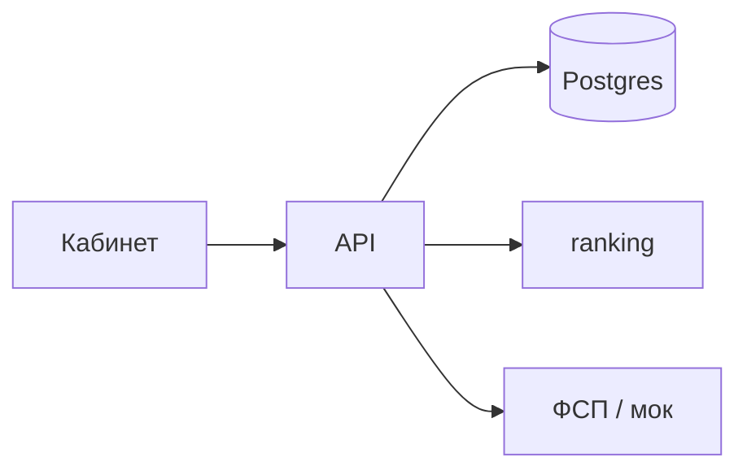

# Как работает

Маркетплейс IT-кандидатов для работодателя, которому нужен не ещё один PDF, а человек с подтверждённым грейдом и навыками. В подборку не попадает «я так написал в резюме»: кабинет смотрит на тест, заявленное против проверенного и, если кандидат привязал ID, на реестр ФСП.

Это обзор. Стек, формулы ranking и как поднять compose на соседних страницах.

## Два кабинета

Кандидат собирает анкету, проходит тест, может связать профиль с ФСП и отвечает на приглашения.

Работодатель описывает потребность, видит подборку с объяснением «почему подходит» и отправляет приглашение с вилкой.

Публиковать вакансию на всю сеть и откликаться «с улицы» в MVP нет: рынок здесь приглашение, не доска объявлений.

Исходник рисунка кабинетов: `site/excalidraw/how-cabinets.excalidraw`. Когда будет SVG, вставка:

```md

```

## Прогон запроса

Кабинет ходит в Nest. Люди и вакансии лежат в Postgres. Подборку считает отдельный ranking (`POST /rank`, в UI score от 0 до 100). Реестр ФСП снаружи; в разработке это мок. Если реестр молчит, подборка не падает.



## Сценарий

Кандидат регистрируется, заполняет анкету и сдаёт тест. Появляется подтверждённый грейд. В пул потребности он попадает, если специализация совпала и грейд рядом с тем, что просит работодатель.

Работодатель видит порядок и причины, шлёт приглашение. Кандидат принимает или отклоняет.

## Куда дальше

- [Стек](/stack/): почему SPA, Nest, ranking и мок ФСП
- [Антисписывание](/integrity/): целостность попытки теста
- [ФСП](/fsp/): зачем реестр; [как устроен мок](/stack/fsp-mock)
- [Код](/code/): карта репозитория

Локальная разработка и развёртывание появятся в этом разделе. Пока репозиторий: [GitHub](https://github.com/DjonniStorm/hh-but-it-works).
