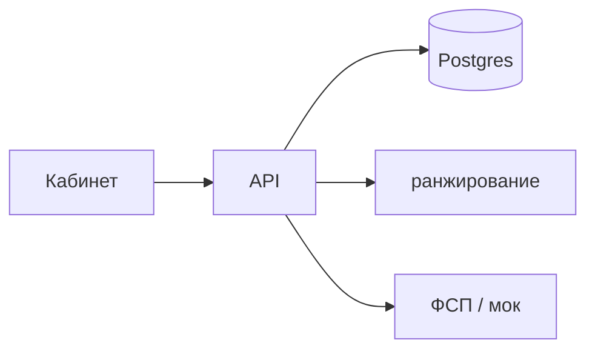

# Как работает

Маркетплейс IT-кандидатов для работодателя, которому нужен не ещё один PDF, а человек с подтверждённым грейдом и навыками. В подборку не попадает «я так написал в резюме»: кабинет смотрит на тест, заявленное против проверенного и, если кандидат привязал ID, на реестр ФСП.

### Быстрый просмотр

- [Локальный запуск](/how/local)
- [Стек](/stack/)
- [Ранжирование и ML](/stack/ml)
- [Интерфейс](/stack/web)
- [Backend](/stack/backend)
- [Инфраструктура](/stack/infra)
- [Мок ФСП](/stack/fsp-mock)
- [Антисписывание](/integrity/)
- [ФСП](/fsp/)
- [Код](/code/)
- [Дорожная карта](/roadmap/)
- [Ссылки](/links)

## Два кабинета

Кандидат собирает анкету (набрать руками или залить PDF), проходит тест, может связать профиль с ФСП и отвечает на приглашения.

Работодатель описывает потребность, видит подборку с объяснением «почему подходит» и отправляет приглашение с вилкой.

Публиковать вакансию на всю сеть и откликаться «с улицы» в MVP нет: рынок здесь приглашение, не доска объявлений.

## Прогон запроса

Кабинет ходит к серверу. Люди и вакансии лежат в БД (Postgres). Подборку считает отдельный сервис ранжирования (`POST /rank`, в UI score от 0 до 100). Реестр ФСП снаружи; в разработке это мок. Если реестр молчит, подборка не падает.

## Сценарий

Кандидат регистрируется и заполняет анкету. Можно набрать поля или залить PDF: сервер снимает текстовый слой (`unpdf`), режет по заголовкам вроде «опыт работы» и experience, контакты ищет регулярками, навыки сверяет с каталогом из БД. Нейросеть для разбора не вызывается. Скан без текстового слоя разбор не даст. Черновик попадает в форму, кандидат правит и сохраняет, потом сдаёт тест. Появляется подтверждённый грейд. В пул потребности он попадает, если специализация совпала и грейд рядом с тем, что просит работодатель.

Работодатель видит порядок и причины, шлёт приглашение. Кандидат принимает или отклоняет. Резюме из анкеты скачивается PDF: три раскладки Reactive Resume (MIT), цвета ФСП. Ditto: графитовая шапка и две колонки. Gengar: тёмная боковая панель с контактами. Pikachu: крупные инициалы. Кандидат качает из профиля, работодатель из приглашения.

Поднять у себя: [локальный запуск](/how/local). Репозиторий: [GitHub](https://github.com/DjonniStorm/hh-but-it-works).
