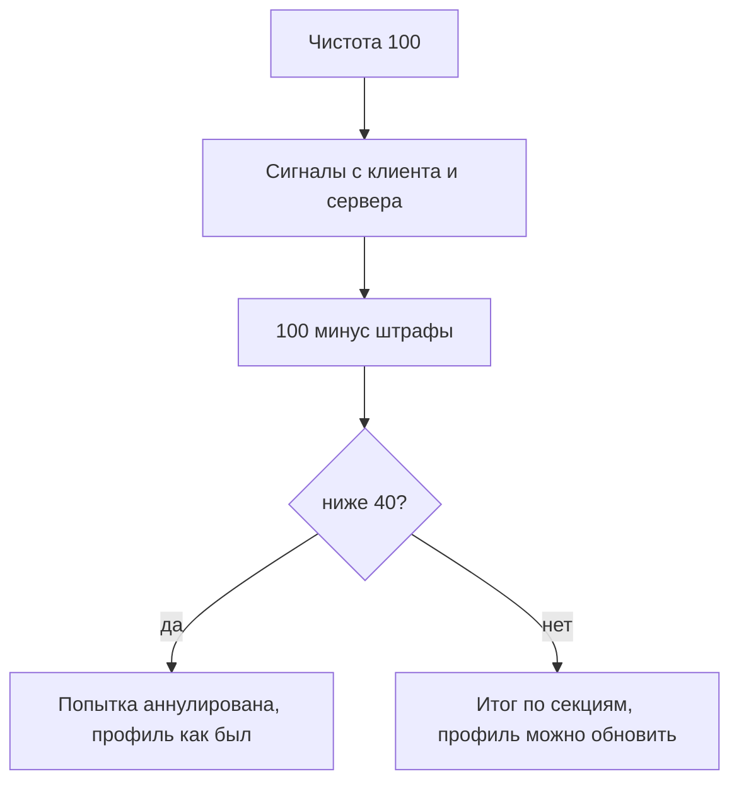

# Антисписывание

Попытка теста живёт в Redis, итог пишется в Postgres. Ответы и верные варианты на клиент не уходят. Вопросы приходят по одному, назад нельзя. Таймер считает сервер: ответ позже срока (с запасом 5 секунд) засчитывается неверным. Новую попытку поверх открытой начать нельзя, иначе можно перебирать вопросы.

Как собираются секции и банки заданий: `docs/dev/testing-validation.md`. Здесь только сигналы целостности.

## Чистота попытки

Старт: 100. Каждый сигнал снимает штраф. Если чистота падает ниже 40, попытка аннулируется и профиль не меняется.

| Сигнал                                   | Откуда                               | Штраф |
| ---------------------------------------- | ------------------------------------ | ----- |
| Уход на другую вкладку                   | `visibilitychange`                   | 15    |
| Переключение на другое окно              | `blur` дольше секунды                | 10    |
| Выход из полноэкранного режима           | `fullscreenchange`                   | 15    |
| Полноэкранный режим не включён           | отказ `requestFullscreen`            | 10    |
| Копирование, вырезание, контекстное меню | `copy`, `cut`, `contextmenu`         | 10    |
| Смена IP                                 | сервер, сравнение с прошлым запросом | 25    |
| Смена браузера                           | сервер, `User-Agent`                 | 40    |
| Ответ быстрее 3 секунд                   | сервер, `servedAt`                   | 10    |

Цифры из `docs/dev/testing-validation.md` и движка `@hh/assessment-engine`.

