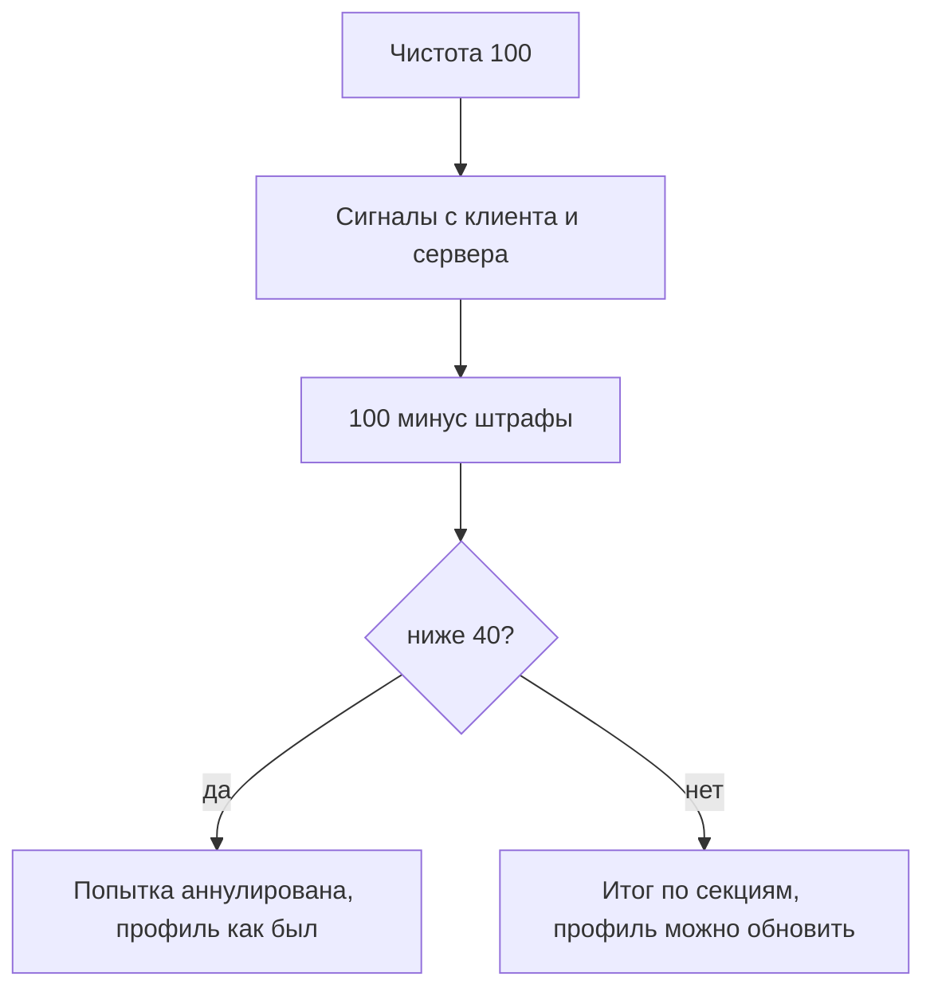

# Антисписывание

Попытка теста живёт в Redis, итог пишется в Postgres. Ответы и верные варианты на клиент не уходят. Вопросы приходят по одному, назад нельзя. Таймер считает сервер: ответ позже срока (с запасом 5 секунд) засчитывается неверным. Новую попытку поверх открытой начать нельзя, иначе можно перебирать вопросы.

## Что входит в попытку

Одна попытка на грейд. Секции собираются из ядра специализации и из навыков анкеты, у которых в банке есть задания.

| Специализация | Ядро                 |
| ------------- | -------------------- |
| Бэкенд        | http-api, postgresql |
| Фронтенд      | typescript, http-api |
| Данные        | postgresql           |
| Безопасность  | http-api, docker     |

Навык без своего банка берёт секцию родственника: Next.js идёт как React, NestJS как TypeScript, FastAPI как Python. Итог пишется навыку банка: сданный TypeScript в анкете станет подтверждённым, NestJS останется заявленным. Нет банка и нет родственника: навык в попытку не входит.

В секции 4 задания. Сначала по одному шаблону на тему, потом добор.

## Как задание появляется

В банке лежат шаблоны, не готовые билеты. У каждой попытки свой seed - случайное число. К нему добавляется код навыка, например `postgresql`, чтобы секции одной попытки не копировали друг друга. Генератор с одним и тем же seed всегда выдаёт одну и ту же последовательность: ту же попытку можно собрать заново, а другая попытка получает другой seed.

Шаблон при сборке подставляет числа, имена, куски SQL или кода. Движок потом перемешивает варианты и шаги, чтобы верный ответ не стоял первым.

Шаблон про `LIMIT` в Postgres рисует ограничение от 2 до 9 и число строк как произведение с множителем от 5 до 12. Формулировка та же, арифметика другая. Часть шаблонов текст не трогает и меняет только порядок вариантов.

Форматы: один ответ, чтение кода, несколько ответов, число, порядок шагов. Таймер у формата свой: 60, 90, 90, 75 и 120 секунд.

Две попытки middle на бэкенде делят 25,2 % шаблонов. Одинаковая формулировка с теми же вариантами: 1,2 %. Пересдача не выдаёт тот же билет.

Секция засчитана от 70. Попытка сдана, если средний балл от 70 и ни одна секция не ниже 50. От 90 профиль предлагает грейд выше.

Для потребности работодателя те же ядро и банк. Навык без заданий возвращается как непокрытый: по нему кандидата этим тестом не проверить.

## Чистота попытки

Старт: 100. Каждый сигнал снимает штраф. Если чистота падает ниже 40, попытка аннулируется и профиль не меняется.

| Сигнал                                   | Откуда                               | Штраф |
| ---------------------------------------- | ------------------------------------ | ----- |
| Уход на другую вкладку                   | `visibilitychange`                   | 15    |
| Переключение на другое окно              | `blur` дольше секунды                | 10    |
| Выход из полноэкранного режима           | `fullscreenchange`                   | 15    |
| Полноэкранный режим не включён           | отказ `requestFullscreen`            | 10    |
| Копирование, вырезание, контекстное меню | `copy`, `cut`, `contextmenu`         | 10    |
| Смена IP                                 | сервер, сравнение с прошлым запросом | 25    |
| Смена браузера                           | сервер, `User-Agent`                 | 40    |
| Ответ быстрее 3 секунд                   | сервер, `servedAt`                   | 10    |

Цифры из `docs/dev/testing-validation.md` и движка `@hh/assessment-engine`.

