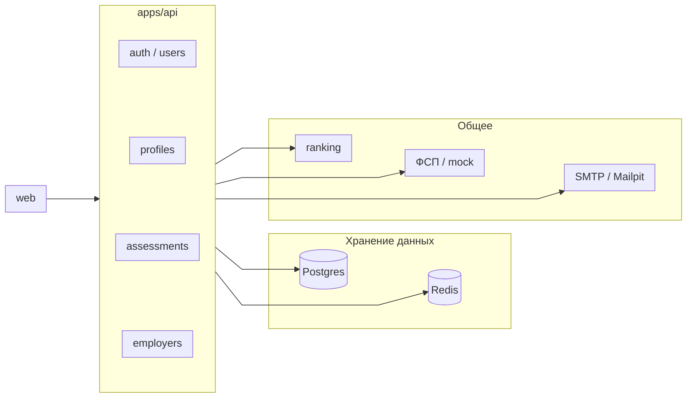

# Backend

## Общий подход

Основным инструментом для построения API в приложении является фреймворк Nest.js. Он предоставляет значительное количество встроенных и готовых решений: dependency injection, модули, guards, pipes, interceptors. Не нужно собирать архитектуру с нуля и договариваться о структуре, она уже задана фреймворком. Плюс общий с фронтендом TypeScript, который позволяет переиспользовать типы и Zod-схемы.

Используется модульный монолитный подход, в котором мы старались уйти от высокой связанности. Модули общаются через явные публичные интерфейсы, а не лезут в чужие репозитории и сущности. В дальнейшем это позволит нам гораздо проще перейти на микросервисы: достаточно будет вынести модуль и заменить вызов на сетевой.

Монолит выбран осознанно: для MVP он быстрее в разработке и проще в развертывании, а один docker compose поднимает всё решение целиком.

## Стек

Основные компоненты backend, которые мы используем:

- Сам Nest.js - Используем платформу над Express.js, для которой есть все нужные нам инструменты. В будущем сначала можно перейти на Fastify для ускорения работы
- BullMQ подключён в корне приложения. Именованных очередей и воркеров нет: письма уходят из `common/mail` в фоне, без очереди
- TypeORM - ORM для работы с базой данных Postgres
- Redis - refresh, токены почты, живая попытка теста, кэш ФСП. Не таблицы предметной области
- Nodemailer - работаем с почтовыми клиентами для отправки писем
- JWT: access HS256, 15 минут, Bearer. Refresh 7 дней в Redis и HttpOnly-cookie. Пароль: bcrypt, cost 10. Пакеты passport-jwt и bcrypt
- Zod-схемы в `@hh/contracts`, те же ест API

## Взаимодействие с другими частями

- Frontend получает данные по REST API. Клиент генерируется по OpenAPI-спецификации, поэтому контракты на клиенте и сервере не расходятся.
- Подбор кандидатов вынесен в отдельный сервис ranking (POST /rank). Backend отправляет ему данные и умножает полученный matchScore на 100 для UI. Подробности в разделе про рекомендательную систему.
- Почта на dev-окружении уходит в Mailpit.

## Организация кода

Пять доменных модулей в `apps/api/src/modules`. Общее лежит в `src/common`, не внутри модуля: JWT/роли, почта, клиент ФСП.

| Модуль        | Зачем                                                            |
| ------------- | ---------------------------------------------------------------- |
| `users`       | Пользователь в Postgres, роль                                    |
| `auth`        | Регистрация, вход, refresh в Redis, подтверждение и сброс пароля |
| `profiles`    | Анкета кандидата, навыки, PDF, привязка ФСП                      |
| `assessments` | Попытка теста: живое состояние в Redis, итог в Postgres          |
| `employers`   | Компания, потребность, пул, подборка, приглашения                |

Backend работает с [mock-ом данных ФСП](/stack/fsp-mock) и с [ML-частью](/stack/ml).
