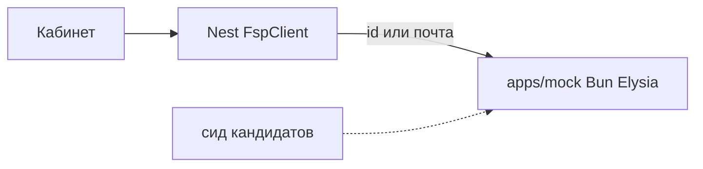

# Работа с ФСП

## Общий подход

Так как команда имела возможность самостоятельно реализовать сервис для интеграции с ФСП, мы реализовали его по-своему.

## Стек

Мы использовали среду выполнения JavaScript/TypeScript - [Bun](https://bun.com/)

Благодаря чему мы получили быстрый и небольшой сервис со множеством решений.

## Доступ и документация

- Сам сервис работает по адресу: https://fsp-mock.eegov.net
- Спецификация OpenAPI (Swagger) открывается по адресу: https://fsp-mock.eegov.net/docs

## Организация сервиса

Две ручки реестра: `GET /participants/:fspId` и `GET /participants/by-email/:email`. Эмуляция входа по OIDC: `/authorize` и `POST /token`. Люди и соревнования совпадают с сидом API (`fsp-` плюс код кандидата). Детали разрядов и грамот живут в моке, в сиде их нет.

