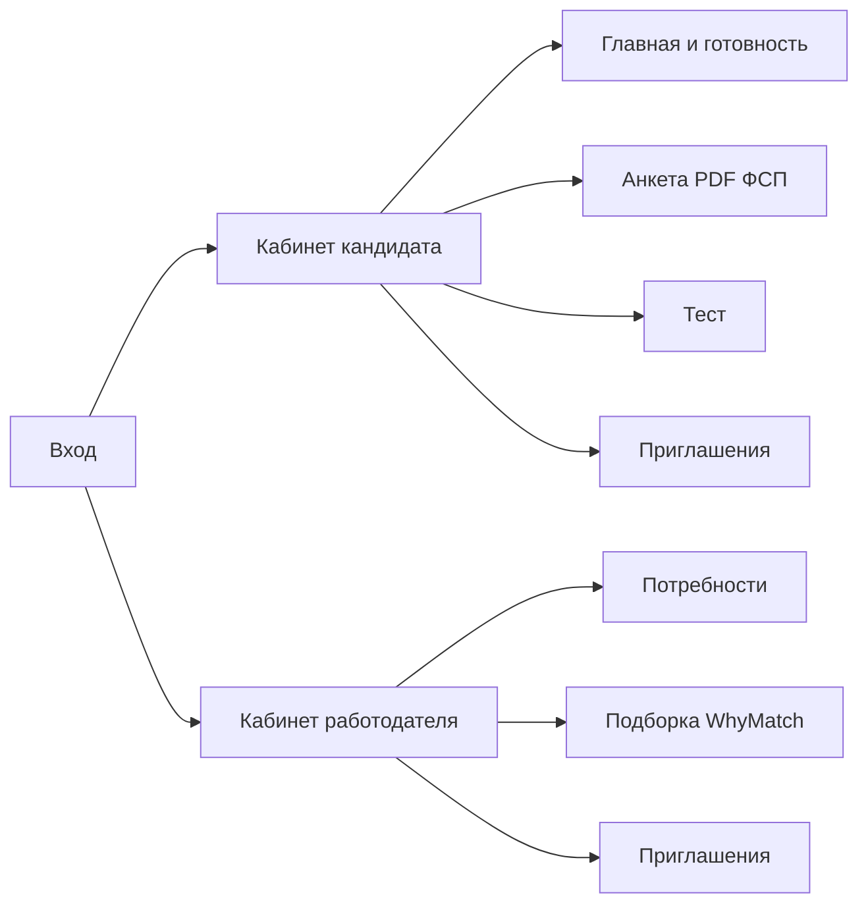

# Пользовательский интерфейс

## Общий подход

Рассматривались два устройства кабинета: единый SPA и микрофронтенды на Module Federation. iframe и web components не рассматривались.

Стартовая точка: один SPA. Один бандл Vite, общая тема, общие Zod-схемы из `@hh/contracts`. Кандидат и работодатель уже разделены маршрутами и своими областями состояния, каждый клиент получает оптимизированный бандл с помощью разделения кода и ленивой загрузки нужных частей (lazy loading). Данный подход - оптимальная отправная точка, которая позволяет быстро реализовать нужные функции системы, а также возможность в дальнейшем разделить UI на Module Federation приложение, разбив зоны ответственности по доменам. Недостаток SPA для поисковой выдачи смягчается библиотекой `@unhead` (заголовок, описание, `public/og.svg`). Экраны подгружаются лениво.

Целевая точка: разделить кодовые базы по доменам. Границы уже заданы каталогами `pages/profile`, `pages/employer` и `shared`. Когда backend режут на сервисы или команд растет, эти части выносятся через Module Federation. Сейчас делить UI при одном бэкенде рано. Это отложенный шаг, по той же логике, что у API: сначала явные модули, затем вынос за сеть.

Не строили свой "фреймворк над React". Сборка: Vite.

## Стек

- React и TypeScript
- MobX: реактивное состояние кабинетов
- Mantine: компоненты
- Zod: схемы из `@hh/contracts`, те же на сервере
- nuqs: состояние в URL
- `@unhead`: SEO-мета

Клиент API генерируется по OpenAPI (`pnpm openapi`, каталог `shared/api/generated`, руками не правится). Формы: `@mantine/form` и `schemaResolver` со `{ sync: true }`, чтобы Zod не уходил в Promise.

## Организация кабинетов

Маршруты описаны в `shared/router/routes.ts`. `ProtectedRoute` ждёт восстановления сессии (`auth.restoreSession()`): access-токен в памяти, refresh в HttpOnly-cookie `hh_refresh`. `CandidateRoute` и `EmployerRoute` пропускают по полю `role`. Работодатель не попадает в лобби теста, кандидат не попадает в подборку.

1. Кабинет кандидата. На главной: готовность анкеты, слайд подготовки, материалы по подтверждённым навыкам, баннер если реестр ФСП нашёл историю по почте.
2. Анкета собрана плитками (контакты, образование, опыт, поиск работы); раздел добавляется кнопкой. В образовании автодополнение вузов и колледжей РФ по списку Wikidata (лицензия CC0); свободный ввод сохраняется. Разбор PDF и выгрузка резюме в трёх шаблонах описаны в [сценарии](/how/). В контактах панель ФСП.
3. Тест идёт через лобби секций, вопросы по одному, затем итог. Сборка попытки и чистота: [антисписывание](/integrity/).

Кабинет работодателя. Потребность, пул, карточка совпадения: оценка от 0 до 100, блоки `WhyMatch`, `ReasonList`, `BreakdownGroup`. Коды причин приходят с API по-английски (`verified_grade_match`, `skill_missing:python`). Русские формулировки лежат в `shared/lib/labels.ts`. Если пункта нет, в карточке показывается исходный код. Приглашение и PDF резюме кандидата используют то же меню шаблонов, что и профиль.

## Состояние и запросы

Собранная модель состояния позволяет сократить "гонки состояния". Пока человек ждёт вход или сохранение (`loader: true`), в набор активных загрузок кладётся идентификатор, оверлей висит, пока набор не пуст. Несколько запросов не ломают друг друга. Для важных запросов используются retry-запросы с разным числом повторов.

Пока оверлей открыт, вместо стандартного спиннера показывается одна из пяти иллюстраций (`RequestLoader`: чиби, утка, кот на клавиатуре, кофе и деплой, node_modules). Картинка выбирается на этот показ и не меняется, пока запрос не закончится.

## Тема ФСП и фон

Тема Mantine собрана под [брендбук ФСП](https://fsp-russia.ru/press/brandbook/): шрифт JetBrains Mono, `primaryColor` `fsp`, оттенок 6. Основной `#402FFF`, акцент `#EC1D35` (`fspRed`), текст `#1B1C21`, фон `#EDEDED`. Для контраста на сером фоне бренда заданы свои приглушённый текст и рамка поля, белая поверхность карточек, цвета статусов приглашения и верификации навыка. Переопределены Input, Combobox, Menu, Popover, PasswordInput: выпадающие списки в портале не серые, лигатуры в URL не склеивают `://`. Файл: `apps/web/src/shared/theme/index.ts`.

На страницах входа и в оболочке кабинета рисуются восемь контурных иллюстраций (кот, утка, кружка, коробка, терминал, баг, призрак, принтер). Набор и места не пересчитываются при каждом рендере: функция `artLayouts` в `shared/decor/model/art-layout.ts` берёт seed и строит раскладку детерминированно.

Seed на логине и регистрации: введённая почта, если в строке есть `@`, иначе значение `guest`. На подтверждении почты и сбросе пароля: токен из ссылки. Строка хешируется FNV-1a, из хеша запускается генератор mulberry32. Генератор перемешивает пул иллюстраций и раскладывает их по слотам: на auth шесть позиций вокруг формы (боковые скрываются на узком экране), в кабинете четыре угла, реже и с меньшей непрозрачностью. Тем же генератором задаются сдвиг позиции на несколько процентов, ширина, наклон в пределах десяти градусов и прозрачность. Одна и та же почта даёт одну раскладку, другая почта даёт другую.
